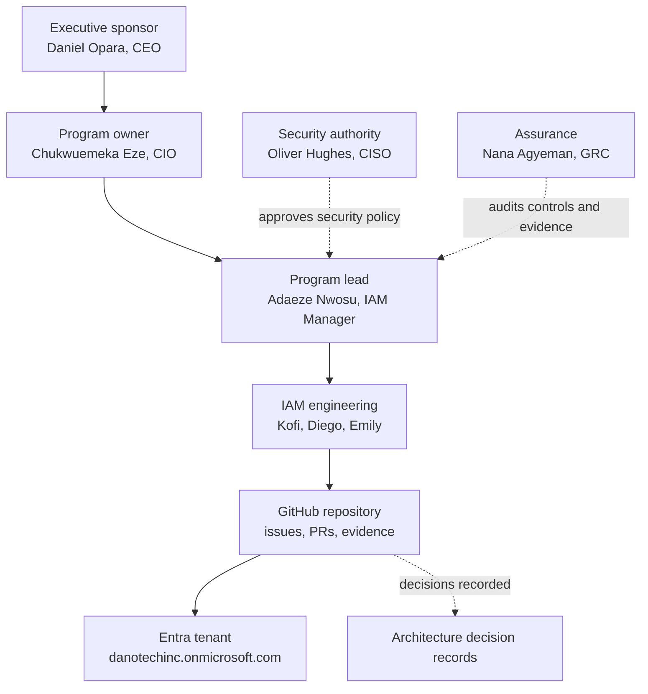
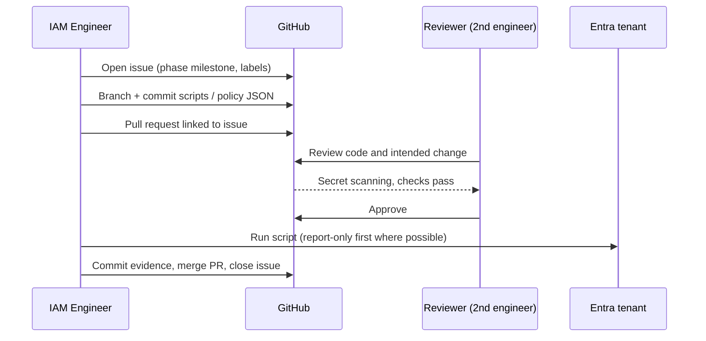

# Phase 00: Program Charter and Governance

## Scenario

DanotechInc grew from 40 to 200 people in three years across five countries. Identity grew with it, unmanaged. A SOC 2 readiness assessment commissioned by the board came back with findings any growing company will recognise:

- **One person holds the keys.** The CEO, Daniel Opara, is the only Global Administrator and uses that account for email and daily work. If his account is phished, the attacker owns the company. If he's unavailable, nobody can administer the tenant.
- **No lifecycle control.** Accounts are created from Slack messages. Nobody can prove that leavers lose access on their last day.
- **No access model.** Access is granted by copying "someone who does a similar job", so permissions accumulate and nobody can explain why a person has what they have.
- **No visibility.** Sign-in and audit logs are kept only for the default retention period, and nobody looks at them.
- **Enterprise customers are asking.** Two prospective customers made SOC 2 Type II and ISO 27001 alignment a contract condition.

Daniel sponsored an Identity & Access Management program, owned by the CIO and delivered by the IAM team. This phase defines how that program is run before any configuration is touched.

## What DanotechInc wants

1. A clear scope, owners and success criteria, so the program can be measured and audited.
2. Naming and documentation standards that every phase follows, so the tenant stays readable as it grows.
3. A Git-based way of working: every change to identity configuration is a reviewed, traceable commit with evidence attached.
4. A decision log, so a future auditor or engineer can see why things were built the way they were.

## Objectives and success measures

| Objective | Measure | Phase(s) |
|---|---|---|
| Eliminate standing privileged access | 0 permanent Global Admin assignments except 2 break-glass accounts | 01, 06 |
| HR-driven lifecycle | 100% of workforce accounts created by the HR feed; leavers disabled within 1 hour of end time | 04 |
| Phishing-resistant authentication | 100% of admins on passkeys; workforce passkey adoption tracked | 07 |
| Single sign-on | All in-scope SaaS apps use Entra ID; no local passwords for workforce users | 08 |
| Least privilege | Every access right traceable to a role in the permission matrix | 03, 05, 09 |
| Governed access | Sensitive access expires or is reviewed at least quarterly | 12, 13 |
| Detection | Sign-in, audit, risk and provisioning logs retained 90+ days and queryable | 01, 14 |
| Audit readiness | Every control mapped to SOC 2, ISO 27001 and NIST CSF with evidence | 17 |

## Scope

**In scope:** Workforce identities (employees, contractors, interns), administrators, guests, workload identities (apps, managed identities, CI/CD), AI agent identities, and the applications listed in the [root README](../README.md).

**Out of scope:** Customer identity (CIAM), on-premises Active Directory (DanotechInc is cloud-only), and endpoint management with Intune. Device-based Conditional Access is designed in Phase 07 but enforced only where it can be tested without managed devices.

## Stakeholders and RACI

R = Responsible, A = Accountable, C = Consulted, I = Informed.

| Activity | Daniel Opara (CEO) | Chukwuemeka Eze (CIO) | Oliver Hughes (CISO) | Adaeze Nwosu (IAM Mgr) | IAM Engineers¹ | Folasade Adeyemi (CPO) | Nana Agyeman (GRC) | Priya Sharma (SecOps) |
|---|---|---|---|---|---|---|---|---|
| Program sponsorship and funding | A | R | C | I | I | I | I | I |
| Tenant hardening, break-glass | I | A | C | R | R | | I | I |
| HR data and lifecycle rules | | A | | R | R | R | C | |
| RBAC and access policy | | A | C | R | R | C | C | |
| Conditional Access and authentication | | C | A | R | R | | I | C |
| Privileged access (PIM) | I | A | C | R | R | | C | I |
| Application SSO onboarding | | A | C | R | R | | | |
| Access reviews and certification | | C | A | R | C | | R | |
| Monitoring and incident response | | I | A | C | C | | | R |
| Compliance mapping and evidence | I | C | A | C | C | | R | |

¹ Kofi Owusu, Diego Ramírez, Emily Carter. Application business owners (for example Fernanda Castillo for Salesforce) are consulted when their app is onboarded.

## Program governance model

Every configuration change flows from an issue, through a pull request reviewed by a second engineer, into the tenant. The evidence of the change (exported JSON, screenshots) is committed back to the phase's `evidence/` folder. That gives GRC a complete, timestamped trail without asking anyone for screenshots after the fact.

## Change workflow

## Licensing and constraints

The tenant runs on **trial** licences for Microsoft Entra ID P2 and Microsoft Entra Suite. Two constraints shape the program:

1. **Trial duration.** Entra trials are typically time-limited (commonly 30 days). This program has 19 phases, so the expiry date is recorded in [`docs/licensing.md`](../docs/licensing.md) during the walkthrough, and the plan is checked against it. P2 and Suite features (PIM, ID Protection, access reviews, Lifecycle Workflows, entitlement management) stop working when the licence lapses.
2. **Seat count.** Trial seat counts can be lower than our 200 users. Licences are assigned through groups (`GRP-LIC-*`) to the personas each phase needs, and the gap is documented rather than hidden.

The domain decision (onmicrosoft.com only) is in [ADR-0001](../docs/adr/0001-use-onmicrosoft-domain.md).

## Program risks

| Risk | Impact | Mitigation |
|---|---|---|
| Admin lockout during Conditional Access rollout | Loss of tenant control | Two tested break-glass accounts excluded from all CA policies (Phase 01); report-only first. |
| Trial licences expire mid-program | P2/Suite features stop | Expiry tracked; licence-dependent phases sequenced inside the trial window or licences purchased. |
| Secrets committed to Git | Credential compromise | Secret scanning with push protection, `.gitignore`, certificate auth (Phase 00 walkthrough). |
| Azure costs from log ingestion | Unexpected spend | Budget alerts and daily ingestion cap (Phase 01). |
| Single-engineer changes | Unreviewed misconfiguration | Branch rules require one approving review. |

## Deliverables

- This charter
- [Naming conventions](../docs/naming-conventions.md)
- Architecture decision records: [ADR-0001](../docs/adr/0001-use-onmicrosoft-domain.md), [ADR-0002](../docs/adr/0002-hr-as-sole-identity-source.md), [ADR-0003](../docs/adr/0003-msgraph-powershell-primary.md)
- GitHub repository configured with branch rules, secret scanning, milestones and a project board ([walkthrough](WALKTHROUGH.md))
- Licensing record (`docs/licensing.md`)

**Next:** [Phase 01: Tenant foundation and hardening](../phase-01-tenant-foundation/)
