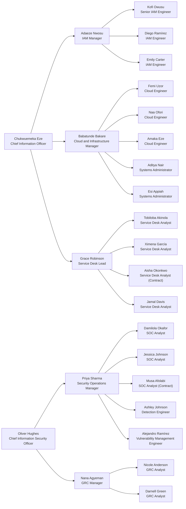

# DanotechInc Organisation Chart

> Generated from [`employees.csv`](employees.csv). Regenerate the CSV with `python generate_employees.py`; it is deterministic, so names and IDs stay stable across phases.

## Headcount by department and office

| Department | Atlanta HQ | London | Lagos | Accra | Mexico City | Remote - US | Total |
|---|---|---|---|---|---|---|---|
| Executive Office | 2 | 1 |  |  |  |  | 3 |
| Finance | 7 |  | 1 | 10 |  |  | 18 |
| Human Resources | 3 | 2 | 6 | 1 |  |  | 12 |
| Legal & Compliance | 3 | 3 |  | 1 |  |  | 7 |
| Operations | 6 |  |  | 2 | 1 | 1 | 10 |
| Marketing | 3 | 9 | 2 | 2 | 3 | 3 | 22 |
| Sales | 8 | 7 |  | 2 | 10 | 5 | 32 |
| Customer Success |  | 3 | 3 | 1 | 9 |  | 16 |
| Engineering | 11 | 11 | 7 | 8 | 12 | 5 | 54 |
| Information Technology | 4 | 1 | 7 | 2 | 2 |  | 16 |
| Information Security | 3 | 3 | 2 | 1 | 1 |  | 10 |
| **Total** | 50 | 40 | 28 | 30 | 38 | 14 | **200** |

## Leadership (L7 and above)

The chart below shows everyone at job level L7 or higher and their reporting lines. Department heads report to the CEO, with two exceptions: Customer Success reports to the CRO, and the CISO reports directly to the CEO rather than the CIO. That second exception is a deliberate separation-of-duties choice: the people who run IT should not also be the people who audit it.

```mermaid
flowchart TD
    DT01001["Daniel Opara<br/>Chief Executive Officer"]
    DT01002["Sophie Bennett<br/>Chief of Staff"]
    DT01004["Kwame Asante<br/>Chief Financial Officer"]
    DT01005["Folasade Adeyemi<br/>Chief People Officer"]
    DT01006["Akosua Boateng<br/>General Counsel"]
    DT01007["Jamal Washington<br/>VP Operations"]
    DT01008["Charlotte Davies<br/>Chief Marketing Officer"]
    DT01009["Marcus Thompson<br/>Chief Revenue Officer"]
    DT01010["Lucía Herrera<br/>VP Customer Success"]
    DT01011["Valeria Mendoza<br/>Chief Technology Officer"]
    DT01012["Chukwuemeka Eze<br/>Chief Information Officer"]
    DT01013["Oliver Hughes<br/>Chief Information Security Officer"]
    DT01014["Adaeze Nwosu<br/>IAM Manager"]
    DT01018["Babatunde Bakare<br/>Cloud and Infrastructure Manager"]
    DT01020["Priya Sharma<br/>Security Operations Manager"]
    DT01021["Nana Agyeman<br/>GRC Manager"]
    DT01022["Rachel Okafor<br/>Financial Controller"]
    DT01023["Tunde Afolabi<br/>HR Operations Manager"]
    DT01024["Brandon Collins<br/>Director of Sales - Americas"]
    DT01025["Harriet Walsh<br/>Director of Sales - EMEA"]
    DT01027["Ngozi Balogun<br/>Director of Digital Marketing"]
    DT01028["Arjun Iyer<br/>Director of Platform Engineering"]
    DT01029["Yaw Darko<br/>Director of Product Engineering"]
    DT01030["Carlos Gutiérrez<br/>Engineering Manager - DevOps and SRE"]
    DT01031["Oluwaseun Ogunleye<br/>Engineering Manager - Backend"]
    DT01032["Mariana Torres<br/>Engineering Manager - Frontend"]
    DT01033["Siobhan Kelly<br/>Engineering Manager - Data and AI"]
    DT01034["Efua Tetteh<br/>Engineering Manager - Quality"]
    DT01001 --> DT01002
    DT01001 --> DT01004
    DT01001 --> DT01005
    DT01001 --> DT01006
    DT01001 --> DT01007
    DT01001 --> DT01008
    DT01001 --> DT01009
    DT01009 --> DT01010
    DT01001 --> DT01011
    DT01001 --> DT01012
    DT01001 --> DT01013
    DT01012 --> DT01014
    DT01012 --> DT01018
    DT01013 --> DT01020
    DT01013 --> DT01021
    DT01004 --> DT01022
    DT01005 --> DT01023
    DT01009 --> DT01024
    DT01009 --> DT01025
    DT01008 --> DT01027
    DT01011 --> DT01028
    DT01011 --> DT01029
    DT01028 --> DT01030
    DT01029 --> DT01031
    DT01029 --> DT01032
    DT01028 --> DT01033
    DT01029 --> DT01034
```

## Technology organisation (IT and Information Security)

These are the people who will run, operate and audit the identity platform. The IAM team (Adaeze Nwosu, Kofi Owusu, Diego Ramírez, Emily Carter) builds most of this project. Security Operations and GRC consume its outputs.

