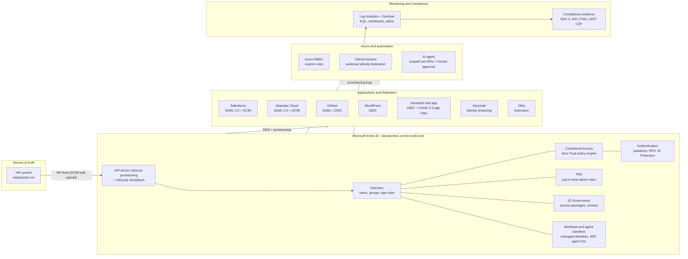

# DanotechInc Identity & Access Management Program

An end-to-end, enterprise-style identity program built on **Microsoft Entra ID** for DanotechInc, a fictional 200-person software company. It covers the whole identity lifecycle, from tenant hardening and HR-driven provisioning through SSO, Zero Trust Conditional Access, privileged access, non-human and AI-agent identities, governance, detection and compliance.

Every phase uses real people from the [HR dataset](data/hr/README.md): Finance analysts in Accra, account executives in Mexico City, SOC analysts in London, contractors whose access expires, interns, pre-hires and leavers. Nothing is demonstrated with a single test user.

## Tenant at a glance

| Item | Value |
|---|---|
| Tenant | `danotechinc.onmicrosoft.com` |
| Licensing | Microsoft Entra ID P2 (trial) and Microsoft Entra Suite (trial) |
| Founding Global Admin | `daniel.opara@danotechinc.onmicrosoft.com` (CEO). Moved off daily admin use in Phase 01. |
| Workforce | 200 people, 11 departments, 6 offices ([org chart](data/hr/org-chart.md)) |
| Automation | Microsoft Graph PowerShell SDK (primary), Python (reporting and data work), Entra admin center |
| Integrated systems | Salesforce, Atlassian Cloud, GitHub, WordPress, Keycloak, Okta, Azure |

## Master architecture

Entra ID sits at the centre as the workforce identity provider. HR is the only way identities get in; every application trusts Entra ID for authentication; every action ends up in the log pipeline.



## Phases

Phases are ordered the way a real program rolls out: secure the tenant, establish the identity source, design the access model, automate it, protect privilege and authentication, then connect applications and workloads, and finally govern, monitor and prove it.

| # | Phase | What DanotechInc gets | Status |
|---|---|---|---|
| 00 | [Program charter and governance](phase-00-program-charter/) | Scope, RACI, naming standards, repo workflow, decision log | Ready |
| 01 | [Tenant foundation and hardening](phase-01-tenant-foundation/) | Break-glass accounts, hardened defaults, baseline CA, automation identity, log pipeline | Ready |
| 02 | [Identity source and HR data model](phase-02-identity-data-model/) | HR schema, attribute mapping, data quality rules | Planned |
| 03 | [RBAC design](phase-03-rbac-design/) | Business roles, permission matrix, access policy | Planned |
| 04 | [JML lifecycle automation](phase-04-jml-lifecycle/) | HR-driven joiner/mover/leaver automation | Planned |
| 05 | [Groups, app roles and OIDC test app](phase-05-groups-app-roles/) | Dynamic and assigned groups, app roles, a working OIDC app | Planned |
| 06 | [Privileged access](phase-06-privileged-access/) | Separate admin accounts, PIM just-in-time roles, approvals | Planned |
| 07 | [Authentication and Zero Trust Conditional Access](phase-07-zero-trust-conditional-access/) | Passkeys, authentication strengths, risk-based policies | Planned |
| 08 | [SSO and federation](phase-08-sso-federation/) | SAML, OIDC, OAuth, SCIM and identity brokering across 6 systems | Planned |
| 09 | [Cloud IAM](phase-09-cloud-iam/) | Least-privilege Azure custom roles | Planned |
| 10 | [Non-human identities](phase-10-non-human-identities/) | Managed identities, GitHub Actions workload identity federation | Planned |
| 11 | [Agent-to-tool authorization](phase-11-agent-authorization/) | AI agent with scoped tool access and human approval | Planned |
| 12 | [Entitlement management](phase-12-entitlement-management/) | Access packages with approval and expiry | Planned |
| 13 | [Access reviews and audit readiness](phase-13-access-reviews/) | Reviews for people and non-human identities | Planned |
| 14 | [Audit logging and monitoring](phase-14-logging-monitoring/) | KQL library, workbook, alerts | Planned |
| 15 | [Identity operations and risk analytics](phase-15-identity-operations/) | Risk triage, ITDR playbooks, operational runbooks | Planned |
| 16 | [Identity vulnerability management](phase-16-identity-vulnerability-mgmt/) | Posture scanning, remediation tracking | Planned |
| 17 | [Compliance mapping](phase-17-compliance/) | Control mapping and evidence pack | Planned |
| 18 | [Capstone](phase-18-capstone/) | Final architecture, lessons learned, portfolio summary | Planned |

Each phase folder contains:
- `README.md`: the business scenario, what DanotechInc wants, target architecture and diagrams.
- `WALKTHROUGH.md`: a step-by-step implementation guide explaining **why** each step is done, not just how.
- `scripts/`: PowerShell (Graph SDK) and Python automation.
- `evidence/`: exported configuration and screenshots that prove the controls work.

## Repository layout

```
danotechinc-entra-iam/
├── README.md                  ← you are here
├── data/hr/                   ← HR master data (200 employees), org chart
├── docs/
│   ├── naming-conventions.md  ← naming standard for every object type
│   └── adr/                   ← architecture decision records
├── scripts/common/            ← shared connection helpers
└── phase-NN-<name>/           ← one folder per phase
```

## Getting started

1. Read [Phase 00](phase-00-program-charter/) for the program scope and conventions.
2. Work through [Phase 01](phase-01-tenant-foundation/WALKTHROUGH.md) to harden the tenant before anything else touches it.
3. Proceed phase by phase. Each phase lists its prerequisites.

## Disclaimer

DanotechInc and all people in this repository are fictional. Any resemblance to real persons is coincidental. No secrets, passwords or certificates are stored in this repository.
